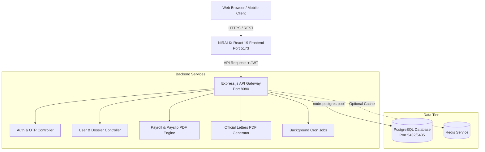

# NIRALIX HRMS — Enterprise Cloud Platform

[](https://react.dev/)
[](https://www.typescriptlang.org/)
[](https://vitejs.dev/)
[](https://nodejs.org/)
[](https://expressjs.com/)
[](https://www.postgresql.org/)
[](https://tailwindcss.com/)
[](#license)

**NIRALIX HRMS** is an enterprise-grade, cloud-native Human Resource Management System engineered for high-performance workforce administration. Featuring a modern, ergonomic **Frosted Ice-Glass Design System**, full mobile responsiveness, role-based security, automated payroll, real-time attendance, KYC document vault, and dynamic organization provisioning.

---

## 🌟 Key Capabilities & Modules

| Module | Features & Capabilities |
|---|---|
| **Enterprise Onboarding** | Self-guided 3-step setup for new organizations. Dynamic Employee ID prefix engine (e.g. `OA1101`, `OA1102`...), Super Admin privilege provisioning, and instant workspace launch. |
| **Dual Authentication** | Secure password authentication + instant **Mobile OTP** verification via SMS gateway with 6-digit individual box input and auto-expiring tokens. |
| **Employee Directory** | Complete employee lifecycle management, multi-department classification, dynamic filtering, designation assignment, and real-time status tracking. |
| **Personal Dossier & KYC** | Comprehensive profile management including Aadhaar, PAN, Voter ID, Passport, blood group, emergency contacts, parent details, and verified document storage. |
| **Attendance & Shifts** | Daily punch tracking, auto-mark absent cron jobs, monthly attendance analytics, custom shift allocations, and holiday planning. |
| **Leave Management** | Multi-tier leave application flow, leave quotas (Casual, Sick, Earned), manager approval workflows, and automated balance reconciliation. |
| **Automated Payroll** | Salary structure configuration, annual CTC breakdown, automated monthly payslip generation, and one-click PDF payslip downloads. |
| **Official Letters Hub** | Automated template generation for **Offer Letters**, **Appointment Letters**, and **Experience Letters** with instant printable PDF downloads. |
| **Document Vault** | Bank-grade encrypted employee document repository with categorization, preview modal, and administrative audit verification. |
| **Org Chart & Feeds** | Visual interactive corporate hierarchy tree showing reporting structures, team leads, department heads, and global company announcement feeds. |

---

## 🏗️ Architecture Overview



---

## 🎨 Master Design System

NIRALIX HRMS is built upon an immutable, ergonomic **Cool Frosty Ice-Blue Sky** design system:

- **Canvas Background:** `#E7EEF6` (Frosty Ice-Blue Sky) layered with ambient radial glow orbs.
- **Surface Cards:** Translucent frosted glass (`rgba(255, 255, 255, 0.65)`) with `backdrop-filter: blur(24px)` and reflective white borders.
- **Primary Buttons:** Solid Deep Navy (`#2F4156`) with smooth dark hover states (`#1e2d3d`).
- **Support & Accents:** Slate Teal (`#567C8D`) and Soft Sky Blue (`#C8D9E6`).

> For complete design specifications, CSS tokens, and component formulas, see [DESIGN_SYSTEM.md](./DESIGN_SYSTEM.md).

---

## 🚀 Quick Start Guide

### Prerequisites
- **Node.js**: v18.0.0 or higher
- **npm**: v9.0.0 or higher
- **PostgreSQL**: v14.0 or higher

---

### 1. Clone the Repository
```bash
git clone https://github.com/your-org/niralix-hrms.git
cd niralix-hrms
```

---

### 2. Configure Backend Environment
Navigate to `HRMS-Backend` and configure `.env`:
```bash
cd HRMS-Backend
cp .env.example .env
```

Ensure your `.env` contains:
```env
PORT=8080
NODE_ENV=development

# PostgreSQL Connection
PGHOST=localhost
PGPORT=5432
PGDATABASE=hrms
PGUSER=postgres
PGPASSWORD=your_postgres_password

# Authentication
JWT_SECRET=niralix_super_secret_jwt_key_2026
JWT_EXPIRES_IN=7d

# Company Contact Defaults
COMPANY_NAME=NIRALIX HRMS
OFFICIAL_EMAIL=harigaran925@gmail.com
OFFICIAL_ADDRESS=Nilgiris, Tamil Nadu, India
```

Install dependencies and start backend:
```bash
npm install
npm run dev
```

---

### 3. Configure Frontend Environment
In a new terminal window:
```bash
cd HRMS-Frontend
npm install
npm run dev
```
Open [http://localhost:5173](http://localhost:5173) in your browser.

---

## 📁 Repository Structure

```
HRMS-Application-main/
├── .github/
│   └── workflows/
│       └── ci-cd.yml             # GitHub Actions CI/CD Pipeline
├── DESIGN_SYSTEM.md              # Immutable Design System & Palette Guide
├── API_ARCHITECTURE.md           # Full API Routes, Schemas & Security
├── CHANGELOG.md                  # Version History & Release Notes
├── README.md                     # Project Master Documentation
│
├── HRMS-Backend/                 # Express.js REST API
│   ├── src/
│   │   ├── app.js               # Application bootstrap & cron registration
│   │   ├── controllers/         # Endpoint request controllers (17 modules)
│   │   ├── db/
│   │   │   ├── pg.js            # PostgreSQL connection pool
│   │   │   ├── schema.sql       # Idempotent database schema definitions
│   │   │   └── repositories/    # Data-access repositories (Clean Architecture)
│   │   ├── services/            # PDF generation, OTP, token signing
│   │   ├── routes/              # Express master routers
│   │   └── cron/                # Automated attendance & shift schedules
│   └── package.json
│
└── HRMS-Frontend/                # React 19 + TypeScript Single Page App
    ├── index.html
    ├── src/
    │   ├── App.tsx              # React router configuration & lazy routes
    │   ├── index.css            # Master design tokens & glassmorphic classes
    │   ├── components/
    │   │   ├── common/          # Atomic UI elements (HariHrmsLogo, buttons, cards)
    │   │   └── layout/          # Sidebar dock, topbar, mobile drawer, footer
    │   ├── pages/               # Feature pages (Dashboard, Onboarding, Login, Profile)
    │   ├── services/            # Axios API client & typed interfaces
    │   └── lib/                 # Auth persistence & session helpers
    ├── tailwind.config.js
    ├── vite.config.ts
    └── package.json
```

---

## 📜 Available Scripts

### Backend (`HRMS-Backend/`)
- `npm run dev`: Starts Express server with `nodemon` live-reload.
- `npm start`: Production Node.js server start.
- `npm run seed:employees`: Seeds 100 enterprise test employee records into PostgreSQL.

### Frontend (`HRMS-Frontend/`)
- `npm run dev`: Starts Vite local development server on port `5173`.
- `npm run build`: Type-checks with `tsc -b` and produces optimized production build in `dist/`.
- `npm run preview`: Locally previews production build.
- `npm run lint`: Runs fast code linting via `oxlint`.

---

## 🔒 Security & Compliance

- **Role-Based Access Control (RBAC):** Strict validation of Super Admin, HR Admin, Manager, and Employee tiers.
- **Password Security:** Multi-round cryptographic hashing using `bcryptjs`.
- **JWT Protection:** Signed Bearer tokens verified via backend authentication middleware.
- **SQL Injection Prevention:** 100% parameterized queries across all database repositories.
- **XSS & Headers:** Enterprise security headers provided via `helmet`.

---

## 📄 License

This software and associated documentation files are proprietary and confidential. Unauthorized copying, distribution, or deployment without explicit authorization is strictly prohibited.

© 2026 **NIRALIX HRMS**. All Rights Reserved.
